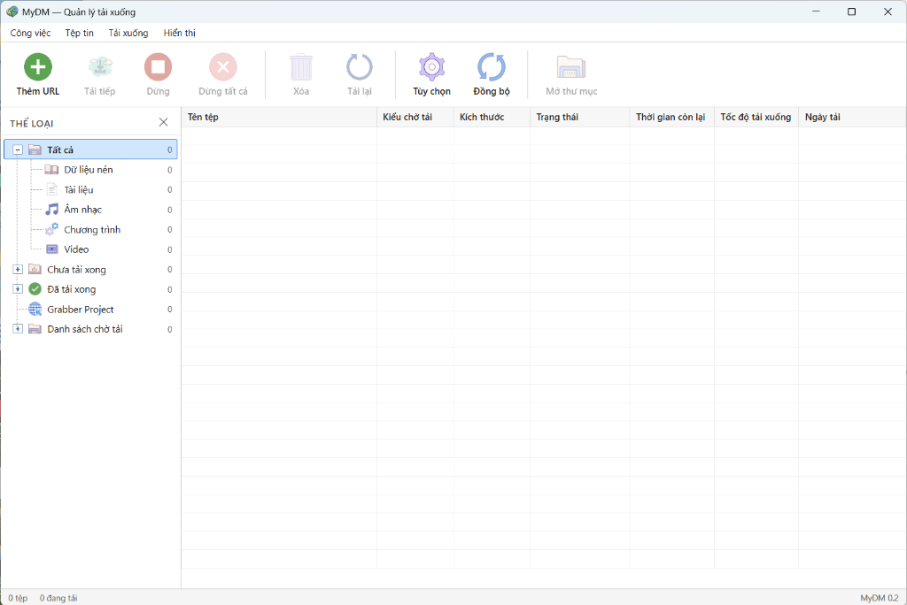

# MyDM 0.3 cho Windows

## 1. Chuẩn bị môi trường Windows 11

Cài đặt:
1. **Rust stable MSVC**: Cài qua [rustup](https://rust-lang.org/tools/install/). Khi installer hỏi, chọn cấu hình mặc định MSVC.
2. **Visual Studio Build Tools**: Chọn workload **Desktop development with C++** và Windows SDK.
3. **Node.js LTS**: Phiên bản LTS hiện hành (kèm npm).
4. **Microsoft Edge WebView2 Runtime**: Thường có sẵn trên Windows 11. Xem thêm tại [Tauri Prerequisites](https://v2.tauri.app/start/prerequisites/).

Mở PowerShell mới sau khi cài đặt và kiểm tra:
```powershell
rustc --version
cargo --version
node --version
npm --version
```

Giải nén/clone dự án vào thư mục thuận tiện (ví dụ `C:\Dev\MyDM`). Nếu PowerShell chặn script `npm.ps1`, sử dụng `npm.cmd` hoặc chạy script với `-ExecutionPolicy Bypass`.

## 2. Chạy ứng dụng trong quá trình phát triển (Dev)

Từ PowerShell tại gốc dự án:
```powershell
powershell -NoProfile -ExecutionPolicy Bypass -File .\scripts\dev.ps1
```
Lần đầu tiên Cargo sẽ tải và biên dịch các thư viện Rust; chờ cho đến khi cửa sổ giao diện MyDM hiển thị.

Cách chạy thủ công từng bước:
```powershell
cd apps\desktop
npm ci
npm run tauri -- dev
```

### Giao diện demo



## 3. Đóng gói bản Portable (Tạo file EXE)

Tại PowerShell ở gốc dự án:
```powershell
powershell -NoProfile -ExecutionPolicy Bypass -File .\scripts\build.ps1
```
Kết quả đóng gói nằm tại thư mục `release\MyDM\`:
- `release\MyDM\mydm.exe`: Ứng dụng desktop.
- `release\MyDM\mydm-native-host.exe`: Cầu nối Chrome Native Messaging Host.
- `release\MyDM\chrome-extension\`: Tiện ích mở rộng Chrome MV3.
- `release\MyDM\install-host.ps1` và `uninstall-host.ps1`: Script đăng ký và gỡ bỏ host trong Registry người dùng hiện tại (HKCU).

## 4. Tích hợp bắt link & tải video Chrome (Phiên bản 0.3)

### Tính năng mới v0.3:
1. **Toàn quyền truy cập mọi website (`<all_urls>`)**: Extension tự động nhận diện liên kết tải và luồng video/audio trên mọi trang web mà không cần cấp quyền thủ công từng domain.
2. **Nút nổi "Tải video này" (Floating Video Download Button)**: Tự động hiển thị ở góc trên trình phát video (YouTube, Facebook, web phim, web nhạc...). Nhấp vào nút mở menu lựa chọn đa chất lượng (1080p HD, 720p HD, 480p, MKV, MP4, phụ đề TTML/VTT) và "Tải xuống tất".
3. **Hộp thoại "Thông tin tệp tin tải xuống" (Download File Info)**:
   - Tự động phân loại nhóm thông minh (*Video, Âm nhạc, Dữ liệu nén, Tài liệu, Chương trình, Chung*).
   - Tự động chọn thư mục lưu theo nhóm, kèm nút `[...]` duyệt thư mục và checkbox ghi nhớ.
   - Thăm dò kích thước file thực tế (Pre-probe) trước khi tải và hiển thị icon tệp trực quan.
   - 3 nút: *Sẽ tải sau*, *Bắt đầu tải*, *Hủy bỏ*.
4. **Cửa sổ "Tiến trình tải xuống đa luồng" (Download Progress Window)**:
   - Thanh đồ họa phân đoạn (visual graphic segment bar) và bảng phân luồng thể hiện tiến trình thời gian thực của từng kết nối song song.
   - Hiển thị tốc độ tải, ETA, hỗ trợ tạm dừng/tiếp tục.
5. **Hộp thoại "Đã tải xong" (Download Complete Dialog)**:
   - Hiển thị khi file tải và ghép hoàn tất.
   - Hỗ trợ 4 nút: *Mở* (Open), *Mở bằng...* (Open with), *Mở thư mục* (Explorer select), *Đóng*.
6. **Hộp thoại "Xác nhận xóa tệp tin" (Delete Confirmation Dialog)**:
   - Thay thế hoàn toàn popup trình duyệt `window.confirm` (`localhost:1420`).
   - Cung cấp 2 lựa chọn: *Chỉ xóa khỏi danh sách MyDM* (giữ an toàn tệp trong máy) hoặc *Xóa cả trong danh sách và xóa vĩnh viễn tệp trong thư mục*.

### Bước 1: Cài đặt Chrome Extension
1. Mở Chrome, truy cập `chrome://extensions/`.
2. Bật công tắc **Chế độ dành cho nhà phát triển** (Developer mode).
3. Nhấp **Tải tiện ích đã giải nén** (Load unpacked) và chọn thư mục `release\MyDM\chrome-extension` (hoặc `apps\chrome-extension` khi dev).
4. Sao chép chuỗi **ID** của tiện ích (chuỗi 32 ký tự, ví dụ `abcdefghijklmnop...`).

### Bước 2: Đăng ký Native Messaging Host
Mở PowerShell và chạy lệnh đăng ký cho tài khoản Windows hiện tại (không cần quyền Admin):
```powershell
powershell -NoProfile -ExecutionPolicy Bypass -File .\release\MyDM\install-host.ps1 -ExtensionId "ID_TIEN_ICH_CUA_BAN"
```
*(Nếu đang dev bằng mã nguồn: xem hướng dẫn đăng ký chế độ dev ở mục bên dưới).*

### Bước 3: Ba chế độ nhận link từ Chrome
Mở popup tiện ích MyDM trên thanh công cụ Chrome:
1. **Chế độ Tắt (Thủ công - Mặc định)**: Không tự động can thiệp tải xuống của Chrome. Để tải bằng MyDM, nhấp chuột phải vào liên kết bất kỳ trên trang web → chọn **Tải link bằng MyDM**.
2. **Chế độ Hỏi trước (Ask)**: Khi một lượt tải bắt đầu trong Chrome, tiện ích tạo tác vụ ở trạng thái `Chờ xác nhận (held)` trên MyDM nhưng **không hủy** lượt tải của Chrome. Bạn mở MyDM để bấm `Tải tiếp` hoặc `Hủy`.
3. **Chế độ Tự chuyển (Auto)**: Tiện ích kiểm tra danh sách domain cho phép (Allowlist) và loại trừ (Blocklist) cùng tùy chọn tên miền phụ. Nếu khớp: MyDM ghi nhận trạng thái `held` → tiện ích hủy download trong Chrome → giải phóng tác vụ MyDM sang hàng đợi (`queued`). Nếu Chrome đã hoàn tất trước khi chuyển thì tác vụ MyDM tự động hủy để tránh trùng lặp.

### Bước 4: Tải bằng phiên đăng nhập (Cookie / Session Sites)
Bản 0.2 cho phép tải các tệp yêu cầu đăng nhập trên các trang web cụ thể:
1. Trong popup tiện ích Chrome, tại mục **Phiên đăng nhập**, nhập domain trang web (ví dụ `drive.google.com` hoặc `fshare.vn`) và nhấn **Cấp quyền**.
2. Chrome sẽ hiển thị hộp thoại cấp quyền truy cập cookie cho website đó (`optional_permissions`).
3. Khi tải link từ domain này, tiện ích sẽ lấy cookie phù hợp và gửi kèm Referer sang MyDM.
4. **Bảo mật**:
   - Khi máy chủ redirect sang tên miền khác (cross-origin), engine MyDM sẽ tự động loại bỏ Cookie và Referer để tránh rò rỉ thông tin xác thực.
   - Cookie không bao giờ được ghi vào log hệ thống và bị loại bỏ khỏi snapshot giao diện UI.
   - Khi tệp hoàn tất, cookie được xóa khỏi siêu dữ liệu.
   - Bạn có thể nhấn **Thu hồi** quyền bất cứ lúc nào trong popup.

### Bước 5: Chẩn đoán kết nối
Popup tiện ích Chrome hiển thị trạng thái kết nối tức thời:
- Kết nối tới Native Host thành công hay thất bại.
- Phiên bản giao thức host (Protocol Version 2).
- Hướng dẫn khắc phục nếu ID hoặc registry chưa đúng.

## 5. Đăng ký Native Host trong chế độ Dev

Khi đang lập trình và chưa build bản release:
```powershell
cargo build -p mydm-native-host --locked
powershell -NoProfile -ExecutionPolicy Bypass -File .\packaging\windows\install-host.ps1 -ExtensionId "ID_TIEN_ICH_CUA_BAN" -HostExe .\target\debug\mydm-native-host.exe
```

## 6. Lưu trữ dữ liệu và an toàn tải xuống

- **Vị trí lưu trữ**:
  - Dữ liệu tạm thời (`*.part`) và cơ sở dữ liệu tác vụ SQLite WAL được lưu tại: `%LOCALAPPDATA%\MyDM`.
  - Tệp tải hoàn chỉnh được chuyển vào thư mục người dùng đã chọn.
- **Tính toàn vẹn**:
  - Tải đa luồng chỉ kích hoạt khi máy chủ hỗ trợ `HTTP Range` và trả về `Strong ETag`.
  - Khi tiếp tục (Resume), engine kiểm tra ETag và Content-Range nghiêm ngặt; nếu ETag thay đổi, tác vụ bị dừng để bảo vệ tính toàn vẹn dữ liệu.
  - Tệp trùng tên không bị ghi đè (tự động thêm hậu tố chỉ số).
  - Tệp hoàn tất không bị xóa khi người dùng xóa lịch sử tải.
  - File lock đảm bảo không có 2 tiến trình engine cùng can thiệp một cơ sở dữ liệu.

## 7. Kiểm thử

Chạy bộ kiểm thử tự động của dự án:
```powershell
# Kiểm thử Engine Rust (8 tests)
cargo test -p mydm-engine -p mydm-native-host --locked

# Kiểm thử Chrome Extension Bridge (8 tests)
node --test tests\chrome_bridge.test.cjs

# Kiểm thử biên dịch TypeScript và Frontend Vite
cd apps\desktop
npx tsc --noEmit
npx vite build
```

Chạy fixture máy chủ HTTP thử nghiệm:
```powershell
python tests\http_fixture.py
```
Sau đó dán liên kết `http://127.0.0.1:8765/slow` vào MyDM để thử nghiệm tạm dừng/tiếp tục tệp 16 MiB.

## 8. Gỡ cài đặt Native Host

Nếu muốn gỡ đăng ký Native Messaging Host khỏi máy:
```powershell
powershell -NoProfile -ExecutionPolicy Bypass -File .\release\MyDM\uninstall-host.ps1
```
Sau đó xóa tiện ích mở rộng khỏi Chrome. Thao tác này không làm mất lịch sử và các tệp đã tải xuống.
